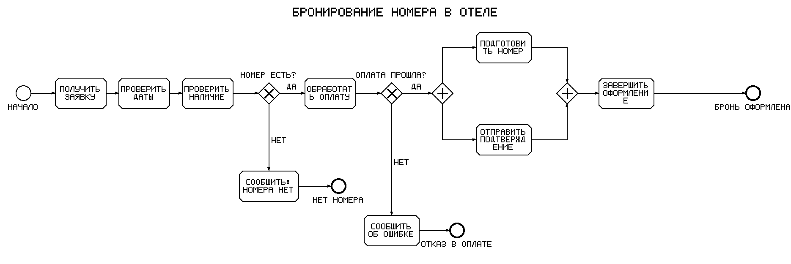
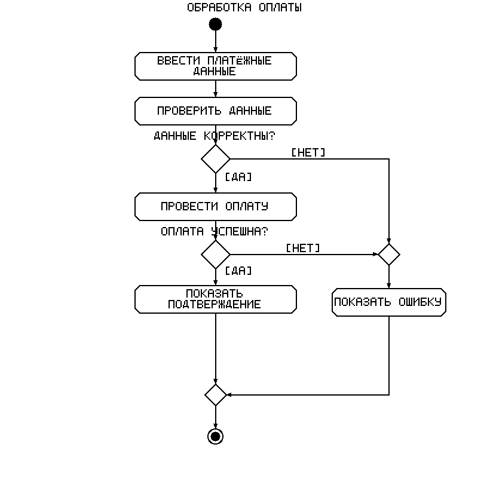
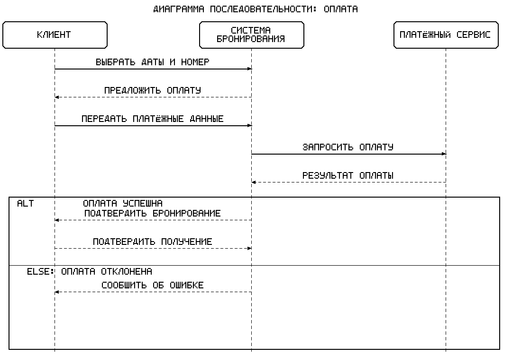
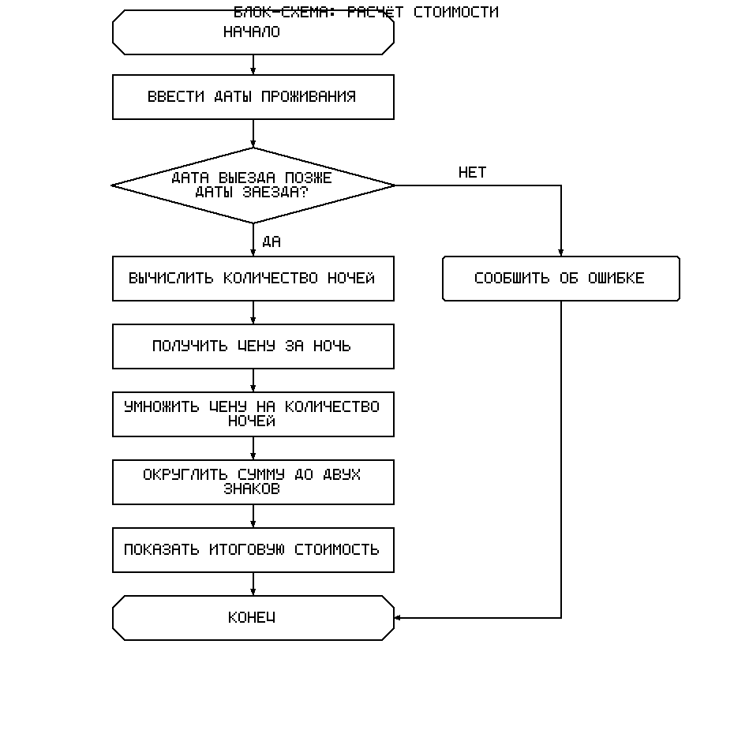

# Лабораторная работа №1

**Тема:** Моделирование процессов с использованием Git и визуальных нотаций.

## Описание процесса

Выбран процесс бронирования номера в отеле. Система проверяет даты и наличие номера, обрабатывает оплату, а при успешном результате подтверждает бронирование. Подготовка номера и отправка подтверждения выполняются параллельно.

[Подробное описание](docs/process_description.md)

## Диаграммы

### BPMN

[Исходник BPMN](diagrams/process.bpmn)

### UML Activity

[Исходник draw.io](diagrams/activity.drawio)

### Sequence Diagram

[Mermaid-код](docs/sequence.md)

### Flowchart

[Mermaid-код](docs/flowchart.md)

## Демонстрация изменений Git

В BPMN добавлена задача «Записать в журнал». В UML Activity добавлено действие записи результата оплаты. В Sequence Diagram добавлено сообщение о получении подтверждения, а в Flowchart — округление стоимости.

- [Изменения BPMN на GitHub](https://github.com/nalemew537-blip/visual-programming-labs-Smirnov/compare/3ee72e2ec7e5431844eff0868b334f250de175d8...7b2cb5789f55f6da04a476572666d8971da2ef15)
- [Изменения UML и Mermaid на GitHub](https://github.com/nalemew537-blip/visual-programming-labs-Smirnov/compare/7b2cb5789f55f6da04a476572666d8971da2ef15...d517268033c6ebef822a1198e8aff14e0491faa7)
- [Текстовый diff BPMN и сведения об изменении PNG](docs/diff-bpmn.txt)
- [Текстовый diff UML и Mermaid и сведения об изменениях PNG](docs/diff-other.txt)

Для текстовых файлов GitHub показывает добавленные и удалённые строки. Для бинарных PNG текстовый patch отсутствует.

PNG подготовлены программно по структуре диаграмм; экспорт BPMN и UML непосредственно из редакторов и проверка открытия исходников ещё не выполнены.

## Вывод

<!-- Вывод необходимо написать самостоятельно после проверки диаграмм и сравнения коммитов. -->
